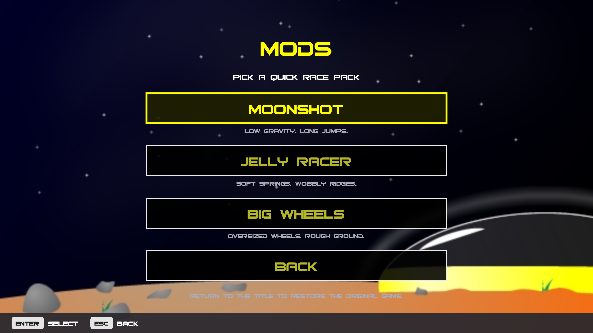
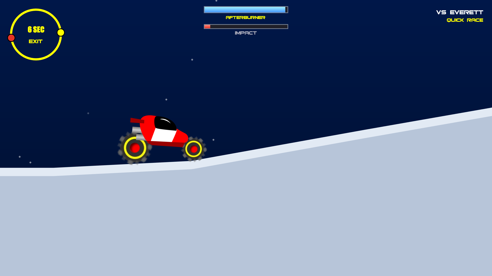
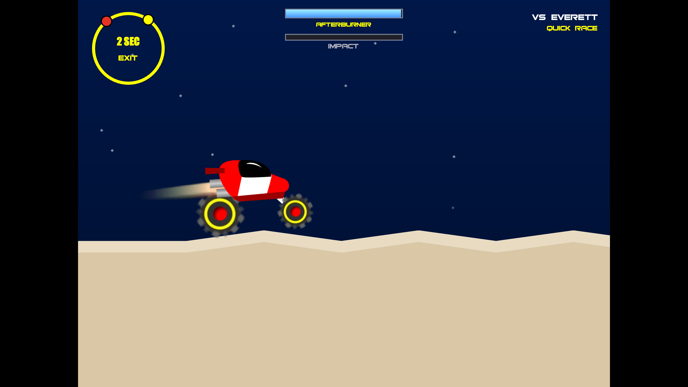
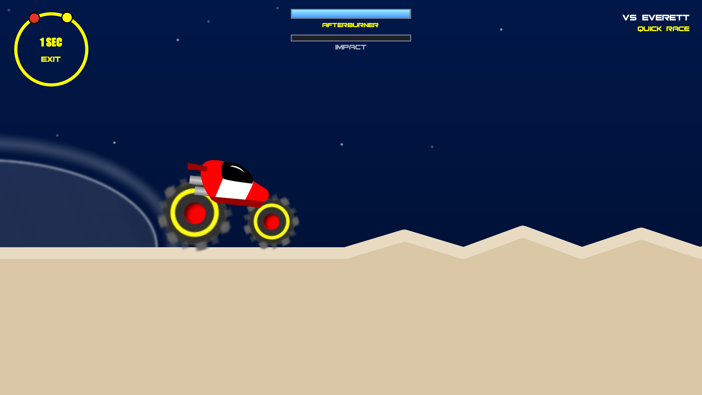

# Planet Racer for Mac

The 2006 Flash hill-racer, running natively on Apple silicon: sharp at any window size, widescreen, smooth at 60 or 120 Hz, with controller support. It plays exactly like the original: the physics and race rules are a line-by-line port of the game's own code.

**Bring your own `planetracer.swf`.** The app ships none of the original art, sound or fonts. They are baked from your copy of the game.

Requires macOS 26 Tahoe or later on an Apple silicon Mac.

## Playing

| | Keyboard | Controller |
|---|---|---|
| Accelerate | Up / W | A or right trigger |
| Reverse / brake | Down / S | B or left trigger |
| Lean back / forward | Left / Right (A / D) | Left stick or d-pad |
| Afterburner | Space | X or right bumper |
| Pause | Esc | Menu / Options |

Land with the car parallel to the slope. Hard landings wreck it. Your rival drives the other way round the planet; the dial in the corner shows you both, and you meet at the finish.

## Settings

All settings are in the in-game **Settings** screen (title menu, pause menu, or ⌘,). They take effect immediately and are remembered in `~/Library/Application Support/Planet Racer/settings.json`, along with your last Quick Race car.

- **Window**: windowed or full screen (Ctrl-⌘-F also works).
- **Framing**: *Widescreen* shows more of the planet ahead; *Original 4:3* keeps the 2006 view.
- **Motion**: *Smooth* draws at your display's refresh rate (up to 120 Hz on ProMotion). *Original 36 FPS* shows the game's own frame rate. Physics always runs at the original 36 ticks per second, so handling never changes.
- **Music** and **Effects** volume.

The game pauses by itself when the window goes to the background or the controller you're using disconnects.

## What's in this version

- **Career**: the original game. Start with a 40 HP car and $10,000 (more on Easy, less on Hard) and work your way up to the King of the Moon. See below.
- **Quick Race**: pick a planet, rival, difficulty, engine, afterburner, chassis, paint and tires, then race. On the Moon you race the King.
- **Mods**: three bundled Quick Race variations: Moonshot, Jelly Racer and Big Wheels.
- Not yet: the high-score game and the map editor. See the roadmap below.

## Bundled mods



From the title screen, choose **MODS**, then **Moonshot**, **Jelly Racer** or **Big Wheels**. This opens Quick Race on the pack's sixth planet with the recommended preset: Everett, Easy, 80 HP engine, sports chassis, high-grip tires and the 5-litre afterburner. Adjust your setup in Quick Race, then race and use **Race Again** to try another line or boost timing.

Returning to the title screen restores the base game automatically and preserves your career. The packs are for Quick Race; they do not modify careers. Their car settings apply to both racers and other tracks while the pack is active. The bundled mods change JSON content; no physics algorithms are changed.

### Moonshot

Lower gravity gives floaty launches and more time to correct a landing. The handmade course has a broad first landing and a second jump.



### Jelly Racer

Softer springs make the existing car flex over shallow ridges, followed by a gentle drop and room to settle.



### Big Wheels

Larger tires give the existing car an oversized buggy stance over sawtooth ridges, rolling dips and a modest climb.



These are short courses: measured successful runs take roughly **8–13 seconds** with the recommended setup. The screenshots show actual driving sessions; they are not rendered mockups. Gravity, terrain, spring stiffness and wheel sizes remain tunable data in [`mods/`](mods/README.md). The packs reuse the assets baked from your own SWF; no baked asset pack is included in the repository.

## Career

Pick **New Career** on the title screen, type a name (or pick one with left/right on a controller) and a difficulty. Up to 5 careers are saved automatically after every change, in `~/Library/Application Support/Planet Racer/career-1.json` … `career-5.json`. **Continue** picks up your last career; **Load Career** lists all five (left/right on a slot switches between LOAD and DELETE; deleting asks first).

- **Garage**: swap between the parts you own with left/right. Every part wears: hard landings and crashes damage the engine and chassis, tires wear out, boosting uses fuel. Press Enter/A on a part to repair or refuel it (40% of its price at full damage). Worn parts make the car slower and slide more.
- **Shop**: buy new parts (stock is limited and restocks each time you come home) or sell yours for up to half their price, less wear. Pick the paint when you buy a chassis.
- **Race**: choose a planet. Travel costs money, and Planets 1 and 2 need a certificate, which you get at reputation 3/10. Rivals pull up one at a time and offer a bet. Accept it, change the amount and **negotiate**, offer to **race for the car** (win: their parts are yours; lose: yours are theirs), or decline. Waste a rival's time too often and they lose their temper.
- **Reputation** rises fastest by beating better drivers. After about 20 rivals and races on a planet it's time to go home, and **Go Home** takes you back to the garage any time.
- **The King**: the trip to the Moon costs $100,000. Beat the King and you get the crown and the kingmobile. Challengers then pay you $100,000 a race, win or lose, until one of them beats you.
- Pausing a career race offers **Abandon race**, which wrecks your car (like the dial's EXIT), so a bad race can't be undone.

## Modding (data files)

Everything about the game's content lives in `data/` as JSON, read at launch:

- `parts.json`: engines, tires, chassis, afterburners. Add entries for new parts.
- `planets.json`: gravity, bumpiness, length, colours. Add a `"map"` to use a hand-built track instead of the random one.
- `maps/sample.json`: an example hand-built track (a list of ground points).
- `opponents.json`: the 32 rivals.
- `rivals.json`: what rivals say when they pull up (offers, refusals, pink slips, the King).

Rival portraits are baked to `assets/sprites/faces/face<face>_<faceframe>.png` (plus `crown.png`); each rival's `face`/`faceframe` in `opponents.json` picks one.
- `cars/default.json`: the soft-body car itself (points, springs, crash rules).

Graphics mods: replace PNGs in `assets/sprites` (4 pixels per game unit; `manifest.json` gives each image's registration point).

---

## For developers

### Layout

```
Sources/PlanetRacerCore/   C++17: data loading, soft-body physics, terrain, race rules (ported from the
                           original ActionScript), behind a plain C interface (include/PlanetRacerCore.h)
Sources/PlanetRacer/       Swift: SwiftUI menus, Metal renderer, GameController input, AVFoundation audio
Sources/RaceSim/           headless race simulator through the same C interface (physics regression test)
tools/                     asset bake from a decompiled planetracer.swf
data/                      base-game data (JSON)
mods/                      bundled Quick Race data packs (JSON)
docs/screenshots/          real driving screenshots of the bundled mods
```

### 1. Bake the asset pack from your SWF

Needs Java, Python 3 with Pillow, and [JPEXS FFDec](https://github.com/jindrapetrik/jpexs-decompiler/releases) (`ffdec-cli.jar`).

```bash
SWF=planetracer.swf; OUT=/tmp/pr; FFDEC="java -Djava.awt.headless=true -jar ffdec-cli.jar"
$FFDEC -swf2xml $SWF $OUT/swf.xml
$FFDEC -export image,sound,font $OUT/raw $SWF
$FFDEC -zoom 4 -selectid 137,141,155,171,188,189,190,191,197,199,201,202,203,554,547,559,331,316,438,448,457,465,469,440 -export sprite,shape $OUT/z4 $SWF
$FFDEC -zoom 8 -selectid 155,171,188 -export sprite $OUT/z8 $SWF
$FFDEC -zoom 4 -format shape:png -selectid 193,195 -export sprite,shape $OUT/z4w $SWF
python3 tools/bake_assets.py --xml $OUT/swf.xml --z4 $OUT/z4 --z8 $OUT/z8 --z4w $OUT/z4w \
  --sounds $OUT/raw/sounds --fonts $OUT/raw/fonts --images $OUT/raw/images --out assets
```

### 2. Build and test

```bash
./scripts/make_app.sh
```

```bash
swift build -c release --product RaceSim && .build/release/RaceSim data 20
```

`RaceSim` races every planet with an autopilot and fails on NaNs or races that never finish.

`RaceSim` also plays a whole career through the C interface (travel, bets, races, repairs, save/load round trips) and fails if cash, reputation or wear go out of range or a save doesn't round-trip.

`PLANETRACER_SHOTS=<folder>` makes the app walk the journey (title, quick race, race, pause, settings, original framing, then a new career: garage, shop, buying, selling, planets, travel, a rival's offer and negotiation, a career race and its results, home, instructions, load, continue) and save real screenshots, then quit. Its careers go to `<folder>/careers`, never your own saves. This is for development only.

The career rules are in `Sources/PlanetRacerCore/career.cpp` (createNewGame, initGarage, clickOkRepair, the shop, clickOkTravel, initOpponents, manageAmount/negotiate, manageEarnings, manageReputation, storeDamage, checkForTrouble), exposed as `pr_career_*` in the C header. The Swift side (`CareerModel.swift`, `CareerScreens.swift`) only shows state and forwards choices.

### Integration tests

```bash
swift test
swift build -c release --product RaceSim
.build/release/RaceSim data 20
.build/release/RaceSim mods/moonshot/data 20
.build/release/RaceSim mods/jelly-racer/data 20
.build/release/RaceSim mods/big-wheels/data 20
```

The model tests cover the Mods entry, loading every pack, restoring the original core and career, preserving the base Quick Race choices when saving settings, and a missing-pack error. They use a separate `.build/test-user` settings directory. Core smoke tests allow ordinary crashes and do not prove human replay appeal or full career progression.

For native integration captures, set `PLANETRACER_SHOTS=<folder>` and `PLANETRACER_SHOT_MOD=moonshot` (or `jelly-racer` / `big-wheels`) when launching the app. `PLANETRACER_USER_DIR=<temporary folder>` isolates all test preferences from the player's files. The app's resource bundle contains all three packs; no resource-root override is needed for normal play.

### Roadmap

1. ~~Career mode~~ (done: garage, wear and repairs, shop, betting and pink slips, reputation, travel, the King).
2. The original's high-score game (three rounds on planets 3, 2, 4) with a local high-score table.
3. Import `planetracer.swf` from inside the app on first launch (no Java/Python), so the app can be shared.
4. Controller rebinding and a Controls page; a mute key.
5. Map editor and arbitrary mod-folder import. Three hand-built Quick Race mods are already bundled.
6. Web and Windows front ends over the same C++ core.
